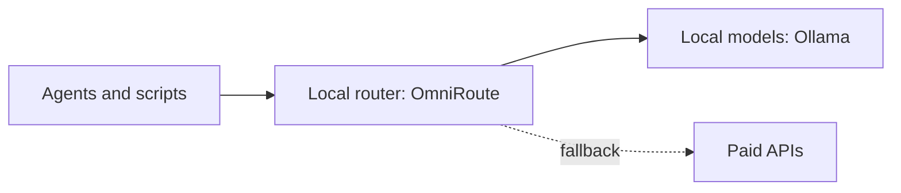

# AI operations lab

**Local-first model routing and agents for infrastructure work**

Role: Designed and built · Status: Ongoing

## The problem

I wanted to use LLM agents for monitoring, RCA and automation without sending everything to paid APIs by default, and to understand model serving and routing hands-on.

## What I planned

- Route every model call through one local gateway, with local models first and paid APIs only as a fallback.
- Build agents and workflows for infrastructure monitoring and automation on top of it.

## Architecture

OpenAI-compatible gateway on the local machine.

## Technologies

OmniRoute, Ollama, Claude, Cursor, MCP

## How AI was used

- This project is the AI work itself: routing, local inference and agents.

## Key decisions

| Decision | Why |
|---|---|
| Local first | Cost and privacy: local models handle what they can, paid APIs only when needed. |

## What I learned

Still in progress.

## Demo

No public demo yet.

## GitHub repo

No public repo yet.

## Activity

Not tracked yet.

## Status

Ongoing
