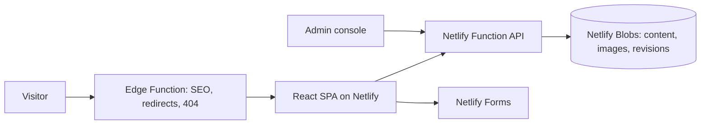

# Azumi Designs website

**A public website with a built-in CMS for an interior design studio**

Role: Designed and built (AI-assisted development) · Status: Live

## The problem

The studio's old site was hard to update and did little to turn visitors into enquiries. The studio needed to publish projects and articles without a developer, keep search rankings from the old URLs, and see where enquiries came from.

## What I planned

- A section-based site the studio can edit itself through a private admin console.
- Server-side SEO, so titles, canonicals and redirects work without a heavy server.
- Lead capture across form, WhatsApp, phone and email, with the source of every enquiry.

## Architecture

Content is one JSON document with the last 30 revisions, so every save is atomic and any change can be undone.

## Technologies

React, Vite, Tailwind CSS, Netlify Functions, Netlify Edge Functions, Netlify Blobs, Netlify Forms

## How AI was used

- Built with AI-assisted development: planning, code and documentation, including an operations runbook and a decisions log.

## Key decisions

| Decision | Why |
|---|---|
| Netlify Blobs instead of a database | The site is small; Blobs needs no extra service and survives deploys. |
| One content document with revisions | Atomic saves and easy undo. |
| Edge Function for SEO | Real titles, canonical URLs, 301s and 404 status without server-side rendering. |
| Optimistic concurrency | Two editors cannot overwrite each other's changes. |

## What I learned

- Plan redirects from the old site before launch; search traffic depends on it.
- A small site still benefits from revisions and conflict checks once non-developers edit it.

## Demo

- [azumidesigns.co.in](https://azumidesigns.co.in)

## GitHub repo

Code is private; activity is summarised below.

## Activity

16 commits across 4 active days, 2026-08-30 to 2026-10-03 (counts only; commit messages stay private).

| Date | Milestone |
|---|---|
| 30-08-2026 | First website |
| 03-10-2026 | Redesign with admin console and CMS backend |
| 03-10-2026 | Project pages, redirects from the old site, lead tracking |

## Status

Live
