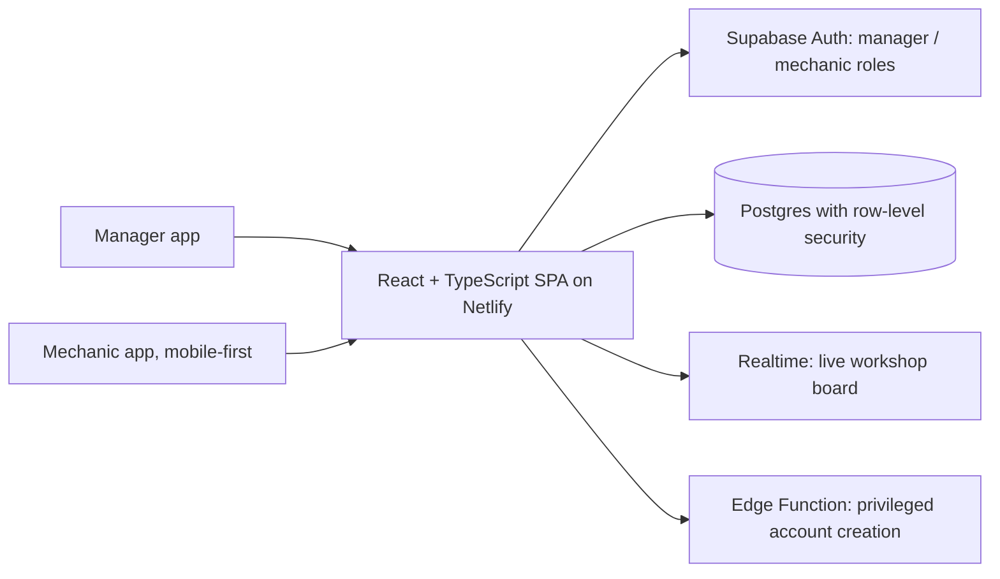

# Garage OS

**An operating system for a motorcycle service centre**

Role: Designed and built (AI-assisted development) · Status: Live, building module by module

## The problem

Getting a motorcycle serviced in India usually means no appointment, no clear price and half a day lost at the garage. Inside the garage, work moves through reception, the manager, mechanics, washing and quality checks, and paper and memory lose track of it. Customers lose trust when extra work appears on the bill without being approved first.

## What I planned

- Map the full service lifecycle first: booking, check-in, inspection, estimate, customer approval, service, wash, quality check, payment, delivery, follow-up.
- Start with one in-house garage, but structure data so more garages can be added later.
- Give managers and mechanics separate experiences: a full manager app, and a mobile-first app that shows a mechanic only their own jobs.
- Build one module at a time, each with an explicit list of what not to build yet.

## Architecture

No custom backend server. The apps talk to Supabase directly with the public key only; data access is enforced in the database.

## Technologies

React, TypeScript, Vite, Tailwind CSS, React Router, Supabase (Postgres, Auth, RLS, Realtime, Edge Functions), Netlify

## How AI was used

- Every module was scoped as a separate task with Claude: inspect the current schema and code first, report findings, then build the smallest usable increment.
- Claude wrote most of the code and migrations; I set the product rules, the scope of each task and the house rules, and reviewed and deployed each step.
- A running docs pack (overview, business context, architecture, schema, flows, decisions, roadmap) keeps each new AI session up to speed.

## Key decisions

| Decision | Why |
|---|---|
| Security in the database, not the front end | Row-level security isolates each garage; mechanics can only reach their own job rows. The service key never ships to the browser; the one privileged action runs in an Edge Function. |
| Additive-only migrations | Every schema change adds and is safe to re-run, so nothing already live breaks. |
| Two experiences, one platform | Mechanics never see revenue, reports or settings, only their jobs and a way to request approval for extra work. |
| Reuse before new tables | Approval requests extend the existing issues table instead of a parallel structure. |
| A small, fixed service catalogue | Thirteen services that match how the garage works, instead of a configurable catalogue nobody would maintain. |

## What I learned

- Scope discipline is what makes AI-assisted building work: each task says what not to build, so the code stays small and reviewable.
- Write down judgement calls as you make them; the decisions log saved re-discovering why two similar tables both exist.
- Delivering changes as archives over a Git checkout can leave deleted files behind; always check git status after applying a drop.

## Demo

- [Live app (sign-in required)](https://bookamech.netlify.app)

## GitHub repo

Code is private; activity is summarised below.

## Activity

14 commits across 5 active days, 2026-08-09 to 2026-08-31 (counts only; commit messages stay private).

| Date | Milestone |
|---|---|
| 09-08-2026 | First version deployed on Netlify |
| 30-08-2026 | Editable digital job cart |
| 31-08-2026 | Mechanic dashboard |

## Status

Live, building module by module
