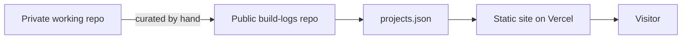

# This portfolio

**A personal site built from an interview, not a template**

Role: Designed and built (AI-assisted development) · Status: Live

## The problem

A CV-style page listed what I had done but not how I think. I wanted a site that shows the engineering first and the person behind it second, without reading like a job-hunting profile.

## What I planned

- Start with an interview, not a layout: what should a visitor remember, and what should they not assume.
- Separate what I engineered from what I helped shape, and say so on every project.
- Keep project detail in this public repo, so the site and the logs never drift apart.

## Architecture

Static HTML with no framework. Project pages read projects.json from this repo, with a built-in copy as a fallback.

## Technologies

HTML, CSS, JavaScript, WebGL, Vercel, GitHub

## How AI was used

- Claude ran the narrative interview, drafted the structure and copy for review, and built the pages.
- Every claim on the site was checked against the project docs; anything unverified was flagged for me to confirm.

## Key decisions

| Decision | Why |
|---|---|
| Interview before design | The site's story came from answers, not from portfolio conventions. |
| Role tags on every project | Engineered work and product collaborations are labelled differently, without ranking them. |
| Public logs, private code | Private repos stay private; only curated summaries and commit counts are published. |

## What I learned

- Deciding what stays private is as important as deciding what to show.

## Demo

- [prafull-patil.vercel.app](https://prafull-patil.vercel.app)

## GitHub repo

[https://github.com/prafull4488/build-logs](https://github.com/prafull4488/build-logs)

## Activity

4 commits across 1 active days, 2026-10-04 to 2026-10-04 (counts only; commit messages stay private).

| Date | Milestone |
|---|---|
| 04-10-2026 | Deployed on Vercel from Git |
| 05-10-2026 | Narrative interview and redesign |

## Status

Live
