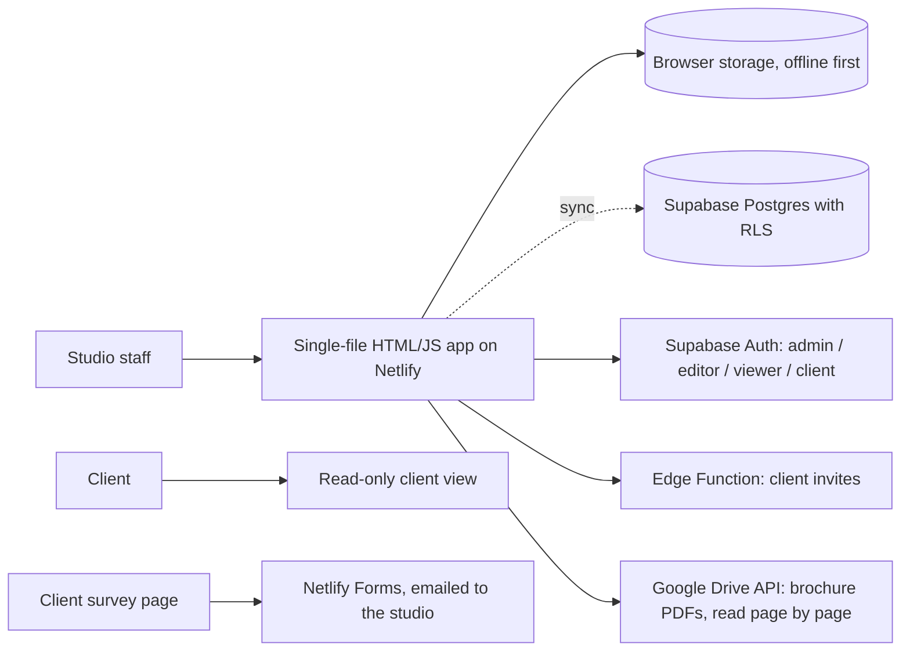
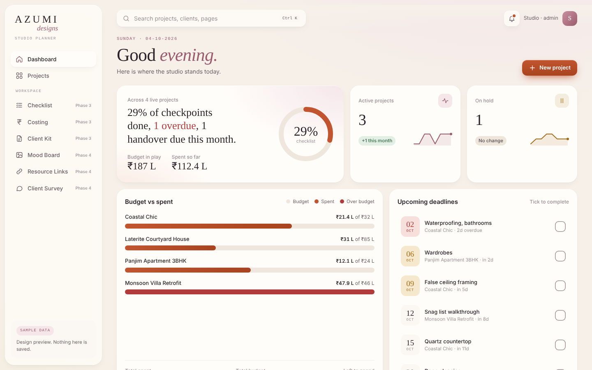
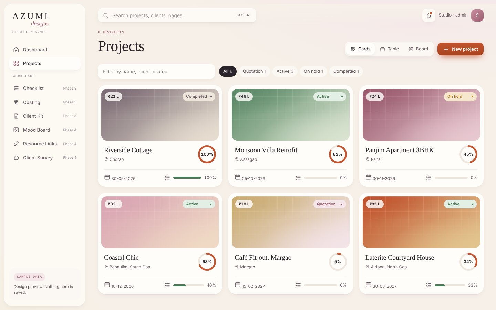
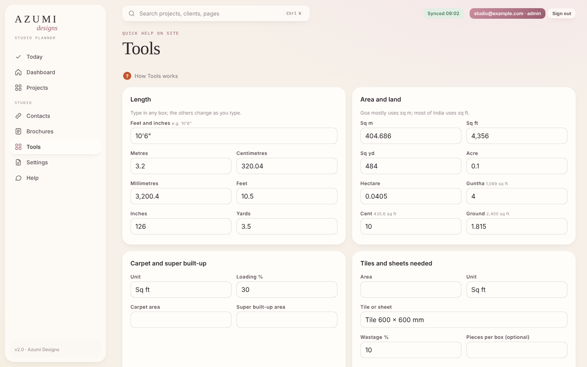
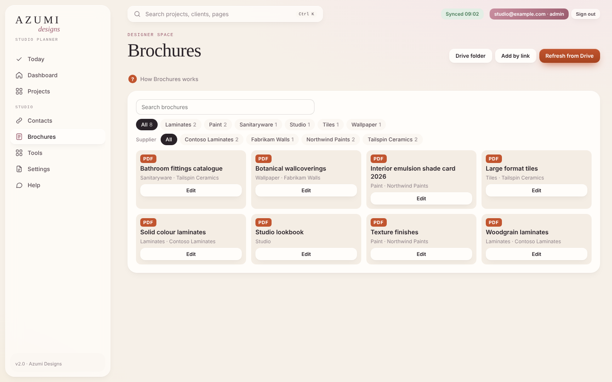
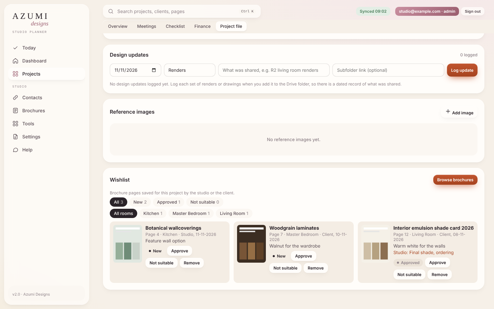

# Azumi Studio Planner

**A studio operating system for an interior design practice**

Role: Designed and built (AI-assisted development) · Status: Live, in daily use

## The problem

An interior design studio was running projects across chats, spreadsheets and notes. Client onboarding was different every time, budgets were tracked separately from scope, and clients had no simple way to see progress.

## What I planned

- One secure web app that runs a project from first enquiry to handover.
- Standardise onboarding: discovery brief, room-by-room scope, clauses, budget and a first-meeting checklist.
- Keep it a single file with no build step, so it is easy to change and deploy.
- Give clients a read-only view of exactly what the studio chooses to share.

## Architecture

Offline first, synced to Supabase. Keys are injected from host environment variables at build time; the public key has no data access on its own.

## Technologies

HTML, CSS and JavaScript (single file, no framework), installable as an app, Supabase (Postgres, Auth, RLS, Edge Functions), Google Drive API and pdf.js (brochure library), Netlify (hosting, Forms), Playwright (release checks)

## How AI was used

- Claude handled planning, code and tests across the redesign, delivered in four phases.
- Every release was checked headless with Playwright at desktop and 375 px before deploying.
- A docs pack (overview, architecture, data model, flows, issues, changelog, design system) carries context between AI sessions.

## Key decisions

| Decision | Why |
|---|---|
| Single file, no build step | Fast to change and deploy; the whole app is one reviewable file. |
| Roles enforced with row-level security | Admin, editor, viewer and client roles; the public key alone cannot read any data. |
| Admin key never in the browser | Creating client accounts and invite links runs in an Edge Function. |
| One room list per project | Scope and checklist share the same rooms, so renaming or removing a room updates both. |
| Everything that needs doing ends up in the checklist | Meeting actions, inventory orders and scope items marked Yes create room tasks; ticking either side ticks both. |
| Categories worked out from wording | Tasks are filed under shared work categories by keyword rules, so existing items needed no data change. |
| Brochures stay where the studio keeps them | Supplier PDFs remain in the studio's Google Drive; folders and subfolders become categories, so the library grows without uploads. Clients save pages to a project wishlist and the studio approves or declines each one. |
| Light features before more data entry | A supplier, order and delivery module was deferred because it needs data kept current every day; the Today page, handover pack and installable app reuse what the studio already enters. |

## What I learned

- Lock down data access before adding features; adding logins and RLS early changed the shape of every later screen.
- Phased redesigns keep a live tool usable while it changes.
- Single-file apps are fast to ship, but user input needs escaping everywhere, not only on new screens.
- Typed shortcuts suit the builder, not the user; plain blocks replaced them.
- Before building a module, ask who will keep its data up to date; the answer decided what was built next.

## Demo

- [Live app (sign-in required)](https://soft-lokum-c2858d.netlify.app/)

## GitHub repo

Code is private; activity is summarised below.

## Activity

57 commits across 11 active days, 2026-06-10 to 2026-11-10 (counts only; commit messages stay private).

| Date | Milestone |
|---|---|
| 10-06-2026 | First version with Supabase sync |
| 04-10-2026 | Logins, roles and row-level security |
| 04-10-2026 | Client view and invites |
| 04-10-2026 | Redesign phases 1 to 4 |
| 05-10-2026 | Client summary charts, budget tab and survey email |
| 14-10-2026 | Project workspace, meeting record with delays by who caused them, architect fees |
| 19-10-2026 | Room inventory with paint schedule and linked checklist tasks |
| 01-11-2026 | Meeting blocks and checklist category filter |
| 02-11-2026 | Simpler projects: five tabs, settings page, next step and needs attention |
| 09-11-2026 | Tools page for site measurements, and a brochure library from Google Drive with project wishlists |
| 11-11-2026 | Today start page with a calendar file, handover pack PDF, installable app |
| 11-11-2026 | Finance expenses by month, newest first, with date filters |

## Screenshots

## Status

Live, in daily use
