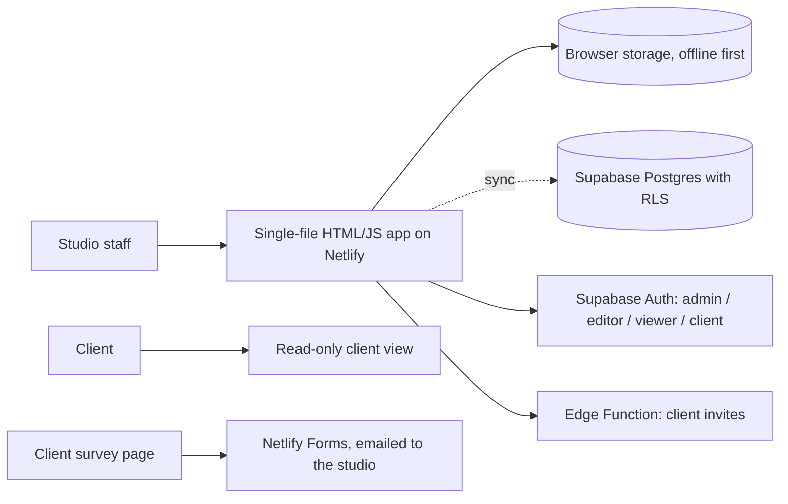
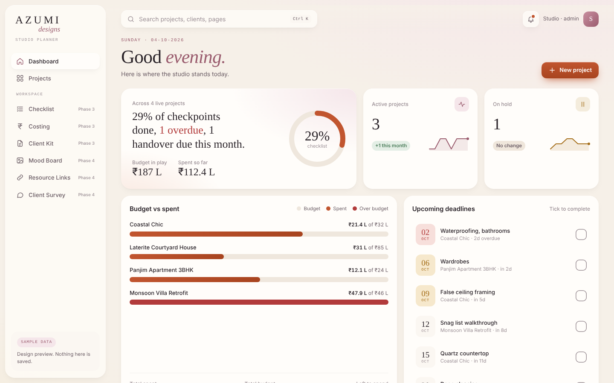
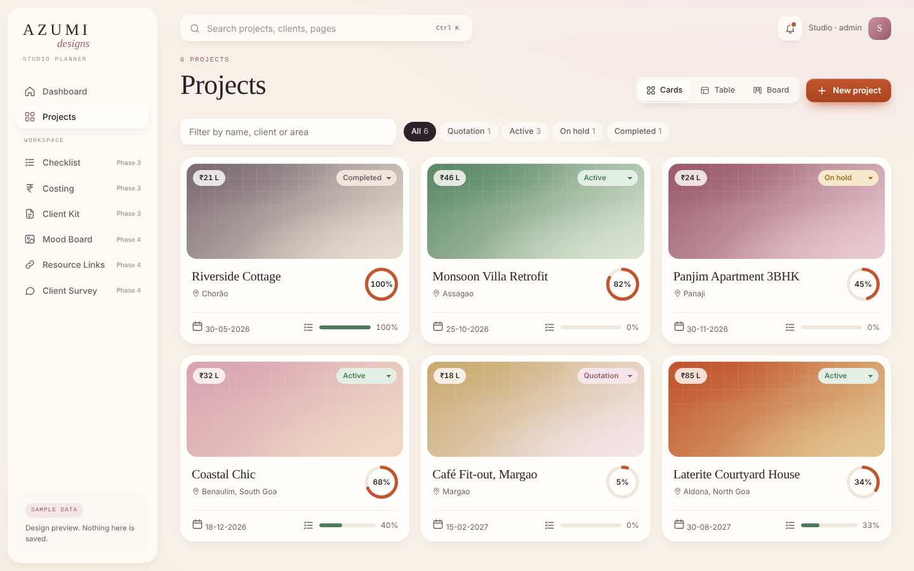

# Azumi Studio Planner

**A studio operating system for an interior design practice**

Role: Designed and built (AI-assisted development) · Status: Live, in daily use

## The problem

An interior design studio was running projects across chats, spreadsheets and notes. Client onboarding was different every time, budgets were tracked separately from scope, and clients had no simple way to see progress.

## What I planned

- One secure web app that runs a project from first enquiry to handover.
- Standardise onboarding: discovery brief, room-by-room scope, clauses, budget and a first-meeting checklist.
- Keep it a single file with no build step, so it is easy to change and deploy.
- Give clients a read-only view of exactly what the studio chooses to share.

## Architecture

Offline first, synced to Supabase. Keys are injected from host environment variables at build time; the public key has no data access on its own.

## Technologies

HTML, CSS and JavaScript (single file, no framework), Supabase (Postgres, Auth, RLS, Edge Functions), Netlify (hosting, Forms), Playwright (release checks)

## How AI was used

- Claude handled planning, code and tests across the redesign, delivered in four phases.
- Every release was checked headless with Playwright at desktop and 375 px before deploying.
- A docs pack (overview, architecture, data model, flows, issues, changelog, design system) carries context between AI sessions.

## Key decisions

| Decision | Why |
|---|---|
| Single file, no build step | Fast to change and deploy; the whole app is one reviewable file. |
| Roles enforced with row-level security | Admin, editor, viewer and client roles; the public key alone cannot read any data. |
| Admin key never in the browser | Creating client accounts and invite links runs in an Edge Function. |
| One room list per project | Scope and checklist share the same rooms, so renaming or removing a room updates both. |

## What I learned

- Lock down data access before adding features; adding logins and RLS early changed the shape of every later screen.
- Phased redesigns keep a live tool usable while it changes.
- Single-file apps are fast to ship, but user input needs escaping everywhere, not only on new screens.

## Demo

- [Live app (sign-in required)](https://soft-lokum-c2858d.netlify.app/)

## GitHub repo

Code is private; activity is summarised below.

## Activity

24 commits across 5 active days, 2026-06-10 to 2026-10-04 (counts only; commit messages stay private).

| Date | Milestone |
|---|---|
| 10-06-2026 | First version with Supabase sync |
| 04-10-2026 | Logins, roles and row-level security |
| 04-10-2026 | Client view and invites |
| 04-10-2026 | Redesign phases 1 to 4 |
| 05-10-2026 | Client summary charts, budget tab and survey email |

## Screenshots

## Status

Live, in daily use
