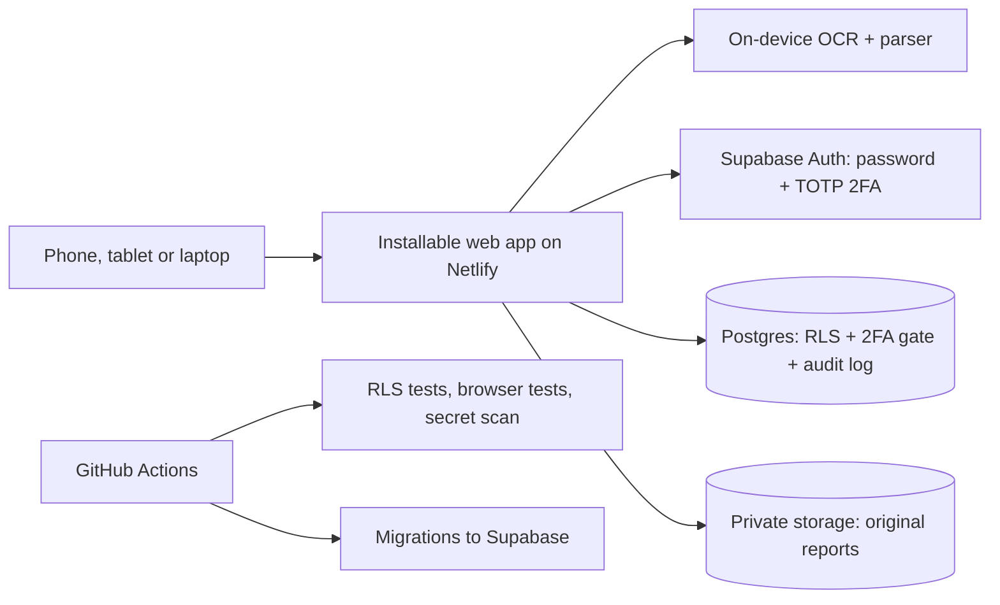
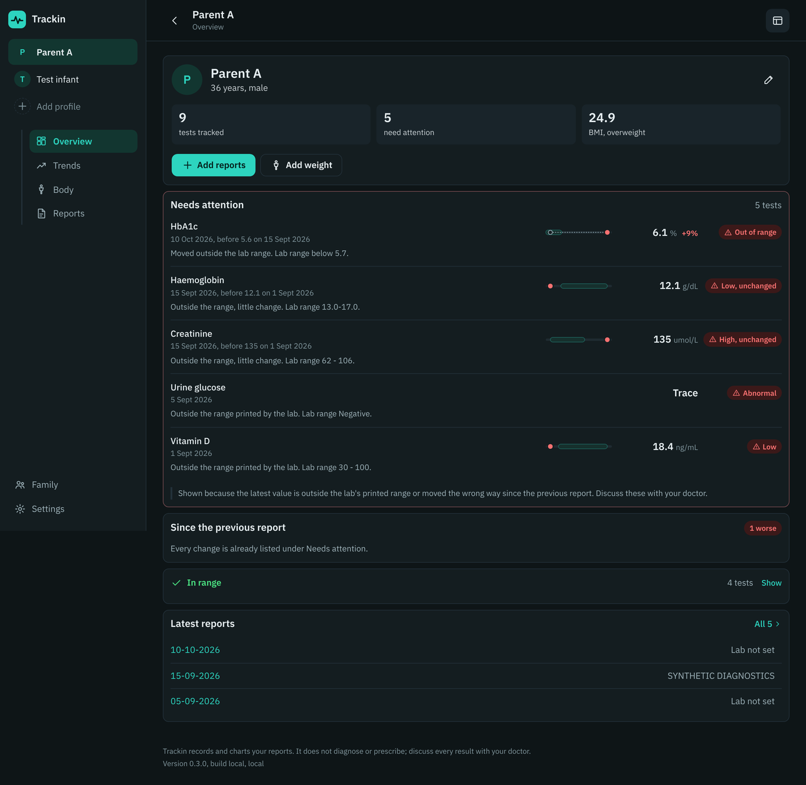
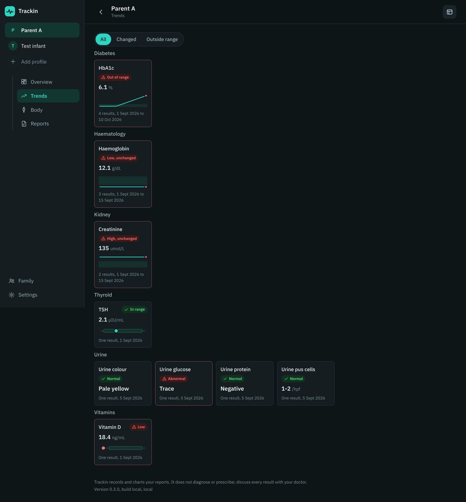

# Trackin

**A private health record for one family, read on the device**

Role: Designed and built (AI-assisted development) · Status: Private beta, in family use

## The problem

A family's lab reports pile up as PDFs, scans and phone photos from different labs, some in another language. Nobody can say whether a value improved since last year, the next vaccine for a baby is tracked on paper, and the reports themselves are among the most sensitive data a family has.

## What I planned

- Start with two profiles, an adult and an infant, and add the rest of the family later.
- Read reports without sending them to any AI service: OCR and parsing in the browser, a confirmation table before anything is saved.
- Show change over time against each lab's own range, with the reason for every highlight, and never prescribe: the decision stays with the doctor.
- Ship a hosted beta first to test from a phone, on components that can move unchanged to a self-hosted Kubernetes stack later.

## Architecture

Netlify holds no health data. Every table has row-level security plus a restrictive policy that requires a 2FA session; the service key never leaves CI. The next phase moves the same app and a self-hosted Supabase to k3s with Helm and Argo CD.

## Technologies

JavaScript (no framework), installable PWA, pdf.js and Tesseract.js (English and Bulgarian OCR in the browser), Supabase (Postgres, Auth with TOTP, RLS, Storage, Edge Functions, pg_cron), Telegram Bot API and Brevo (reminders), Netlify, GitHub Actions, Playwright, WHO growth standards, IAP 2025 vaccine schedule

## How AI was used

- Claude planned, wrote and tested each slice; I set the rules (suggest only, never prescribe; confidential data; plan and approval before every build) and reviewed every change.
- No AI service reads the reports. When the on-device parser misses values, a redacted prompt can be copied to the Claude app by hand and the answer pasted back.
- The parser was checked against real reports locally; the reports themselves never entered Git, and the tests use synthetic layouts only.

## Key decisions

| Decision | Why |
|---|---|
| 2FA enforced in the database | A restrictive policy on every table requires an authenticator session, so a stolen password alone reads nothing. |
| Parse on the device, not with a paid API | Free, instant and private; the trade-off is a rule parser that has to be taught each lab's layout. |
| Suggestions with reasons, never prescriptions | Every highlight says why it is shown and points to the doctor. |
| Hosted beta on self-hostable parts | Supabase and a static app can move to k3s later without a rewrite. |
| Word results as first-class values | Urine routine and screening tests (Negative, Nil, Trace) are saved with a normal or abnormal flag instead of being dropped. |
| A demo that cannot touch real data | The public demo answers every request inside the browser from a fictional family, so sharing the link carries no risk to the family's records. |
| One schedule rule for app and reminders | Whether a dose is due on a date (daily, weekdays, alternate days, days of each month) is decided by the same rule on the phone and in the reminder job, so the screen and the messages never disagree. |

## What I learned

- Real lab reports break neat assumptions: tiered ranges on following lines, units before values, the same word meaning a blood or a urine test depending on the section.
- A scan's OCR confidence is a usable signal: straight scans read reliably, angled photos need a warning and a manual check.
- Test the security model as code: row-level security tests run in CI on every change.

## Demo

- [Live demo with a sample family (nothing is saved)](https://silver-panda-30186b.netlify.app/#/demo)

## GitHub repo

Code is private and the app holds family health records. The live demo runs entirely in the browser with a fictional family and never contacts the real database; screenshots use test data only.

## Activity

31 commits across 6 active days, 2026-10-15 to 2026-10-24 (counts only; commit messages stay private).

| Date | Milestone |
|---|---|
| 15-10-2026 | Design pack: architecture, data model, security and recommendation policy |
| 19-10-2026 | Hosted beta: sign-in with 2FA, profiles, report upload and on-device OCR |
| 21-10-2026 | On-device parser and batch upload; no paid AI |
| 21-10-2026 | Trends, WHO growth charts, vaccine schedule, two views; parser checked against real reports |
| 22-10-2026 | Child record from the baby book; family accounts managed in the app, profiles private unless shared |
| 22-10-2026 | Medicines from prescriptions, a 3-day share link, reminders by Telegram and email |
| 22-10-2026 | Repeating schedules: alternate days, days of each month, weekdays |
| 23-10-2026 | Summary for Doc: one page per visit, private tests left out by default |
| 24-10-2026 | Clans for households, help on every screen, tour video and an in-browser demo |

## Screenshots

## Status

Private beta, in family use
